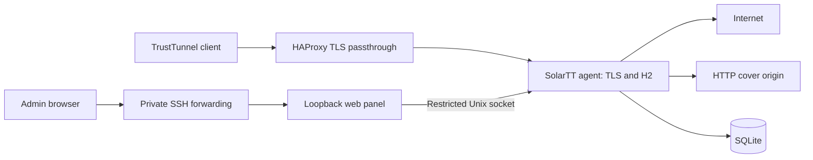

# SolarTT-UI

**Independent, self-hosted management for TrustTunnel.**

A lightweight web panel and managed TrustTunnel endpoint: users, individual
device profiles, traffic quotas, expiry, rotation and revocation. Community
project, not an official TrustTunnel product.

## First public alpha

**v0.1.0-alpha.3** is the first public alpha. Alpha.1 and alpha.2 were development
builds, not public releases. Intended for an operator-supervised single-node
pilot; there is no stable version or guaranteed concurrent-user capacity.

[Download the alpha](https://github.com/precox/SolarTT-UI/releases/tag/v0.1.0-alpha.3)
→ [install on Ubuntu 24.04](docs/install.md)
→ [client setup](docs/client-compatibility.md).
Published assets include the amd64 `.deb`, binary `.tar.gz`, source archive,
SHA256SUMS, build provenance and test reports. No Rust/build tools are required
on the runtime node. Read [requirements](docs/system-requirements.md) and
[security](SECURITY.md) before installing. Keep the panel private over SSH
forwarding; the public TLS route serves the VPN and a separate cover origin.

## Features and boundaries

- Per-user quota shared by all profiles and both traffic directions; expiry and
  calendar resets, durable accounting and documented crash uncertainty.
- Separate profile credentials, rotation, immediate revocation and issued-profile
  limits. A limit counts non-revoked profiles, including offline profiles. It
  cannot distinguish copies of one profile on multiple physical devices.
- Mobile user/device cards and copyable manual Android connection fields.
  Deep link, local QR and TOML are secondary formats, dependent on client support.
- Restricted Unix control socket, encrypted credential storage, audited exports,
  bounded database/audit retention, backup and guarded restore.

Scope: **Ubuntu 24.04 x86_64, one node, HTTP/2, TCP and UDP**. IPv6, QUIC/HTTP3,
ICMP, speed shaping, payments and multi-node orchestration are outside v0.1.
Quota counts forwarded payload, not the provider's network bill. TLS connection
counts describe transports, not physical devices or a fixed sessions-per-phone
ratio. See [architecture](docs/architecture.md).

## Architecture



The package does not alter an existing HAProxy, Caddy, firewall or SSH service.
The default supported topology colocates agent and panel, which communicate
through a local Unix socket; cross-host agent management is not implemented.

## Device setup

In **Access settings**, set a user's issued-profile limit (0–16), or set it when
creating the user. Choose **Add device**, name the device and create its profile.
The primary setup card shows each Android field with Copy buttons: address,
certificate domain, SNI, username, password and HTTP/2. Never publish screenshots
of credentials. Revoke profiles before lowering the limit below the issued count.
One profile per device is recommended for independent rotation and revocation.

## Verification and next iteration

CI covers functional/policy tests, JavaScript session state, real browser tests,
TLS/H2 TCP/UDP, quotas/revocation isolation, package lifecycle and guarded
upgrade/restore on disposable runners. A separate minimal Ubuntu container checks
runtime binaries and packaged instructions without a compiler or browser SDK.
These are different environments and are reported separately.

Android versions/networks, network switching, operational certificate renewal,
off-host recovery and representative 24–72 h resource observation remain stable
acceptance work. See [alpha/stable gates](docs/release-gates.md),
[verification history](docs/verification.md) and [manual pilot](docs/manual-pilot-plan.md).

## Build and contribute

Build prerequisites: Rust 1.95.0, Python 3, C/C++ compiler, CMake and libclang.
Heavy native builds run in CI, not on a shared VPN node.

```sh
python3 scripts/prepare_upstream.py
cargo test --locked
# Full native toolchain required:
cargo test --locked -p solartt-agent -- --test-threads=1
```

[Contributing](CONTRIBUTING.md) · [backup/upgrade](docs/backup-upgrade.md) ·
[proxy integration](docs/proxy-integration.md) ·
[dependency redistribution review](docs/dependency-redistribution-review.md).

## License and acknowledgments

Apache-2.0 for SolarTT-UI. Dependencies retain their original licenses. Exact
upstream pin, patches and third-party attribution texts accompany binary builds.
See [NOTICE](NOTICE) and [dependency notices](docs/dependency-notices.md).

This product includes software developed by the OpenSSL Project for use in the
OpenSSL Toolkit (http://www.openssl.org/). This product includes cryptographic
software written by Eric Young (eay@cryptsoft.com). This product includes
software written by Tim Hudson (tjh@cryptsoft.com).
