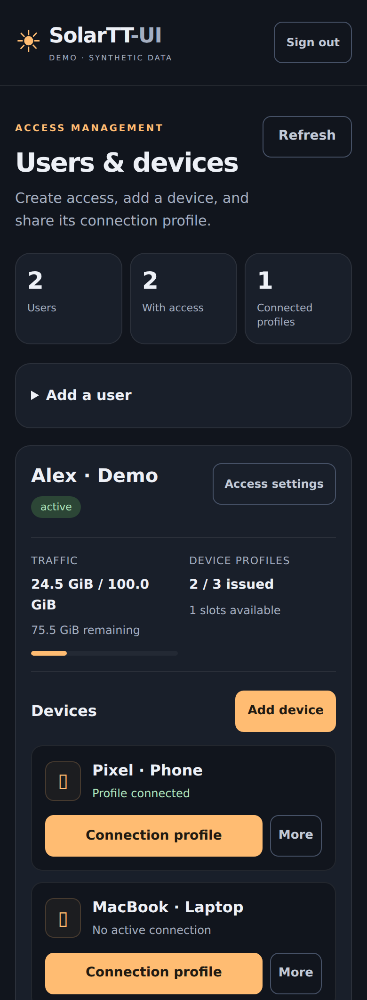
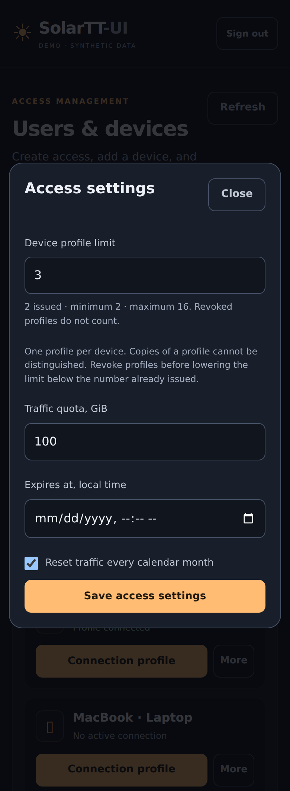

<p align="center">
  
</p>

# SolarTT-UI

<p align="center">
  <a href="https://github.com/precox/SolarTT-UI/releases"></a>
  <a href="https://github.com/precox/SolarTT-UI/actions/workflows/ci.yml"></a>
  <a href="https://github.com/precox/SolarTT-UI/actions/workflows/watch-trusttunnel.yml"></a>
  <a href="LICENSE"></a>
</p>

SolarTT-UI is an open-source web panel and managed endpoint for TrustTunnel.
Create users, issue individual device profiles, set traffic quotas and expiry,
and rotate or revoke access from a desktop or mobile browser. This is an
independent community project, not an official TrustTunnel product.

This page covers installation and everyday use. For development and build
instructions, see [CONTRIBUTING.md](CONTRIBUTING.md).

**Version documented: [v0.1.0](docs/releases/v0.1.0.md).**
Check [GitHub Releases](https://github.com/precox/SolarTT-UI/releases) for published
packages matching this version; a source branch alone is not a binary release.
This first stable release covers operator-managed single-node deployments on
Ubuntu 24.04 x86_64. Network reachability under filtering is not guaranteed.
Concurrent-user capacity, full recovery after host loss and an actual future
certificate replacement remain explicitly unverified. See the
[accepted release scope and limitations](docs/stable-acceptance-2026-10-23.md).

<p align="center">
  
  
</p>
<p align="center"><strong>Users &amp; devices · Access settings</strong><br>
Actual panel UI at a mobile viewport, using synthetic demo data only.<br>
No production users, credentials or traffic are shown.</p>

## Contents

- [Download](#download)
- [Install and first launch](#install-and-first-launch)
- [Quick start](#quick-start)
- [Users and devices](#users-and-devices)
- [Connecting a device](#connecting-a-device)
- [Traffic quotas and expiry](#traffic-quotas-and-expiry)
- [Settings and deployment](#settings-and-deployment)
- [Backups and updates](#backups-and-updates)
- [Building from source](#building-from-source)
- [Automation](#automation)
- [Security](#security)
- [License](#license)

## Download

Get the matching files from the
[v0.1.0 release](https://github.com/precox/SolarTT-UI/releases/tag/v0.1.0):

| Target | File | Use |
| --- | --- | --- |
| Ubuntu 24.04, x86_64, systemd | `solartt-ui_0.1.0_amd64.deb` | Recommended installation; includes service account setup |
| Linux x86_64 binary payload | `solartt-ui-0.1.0-linux-x86_64.tar.gz` | Manual deployment; does not set up service accounts |
| Source code | `solartt-ui-0.1.0-source.tar.gz` | Building and inspecting the release |

The Ubuntu package is the verified deployment target; the binary archive does
not imply support for other distributions. Download `SHA256SUMS` alongside your
chosen file. The release also includes build provenance, dependency information
and test reports. Checksums detect corruption; they are not release signatures.

## Install and first launch

On the target server, use an empty directory for the downloaded `.deb` and
`SHA256SUMS`, then verify and install:

```sh
sha256sum --ignore-missing -c SHA256SUMS
sudo apt-get update
sudo apt-get install ./solartt-ui_0.1.0_amd64.deb
```

Continue only if the package checksum passes. No Rust, compiler, Node or Chromium
is required on the runtime node. See [system requirements](docs/system-requirements.md)
for whole-server planning estimates and the limits of current measurements.

Before starting the services, follow the [installation guide](docs/install.md)
to configure the endpoint and panel, initialize the data key and administrator
password, and supply DNS, a trusted TLS certificate and a local HTTP cover origin.
The package creates accounts and directories; starting and enabling services is
an explicit operator step. Integration with an existing TLS proxy is covered in
[proxy integration](docs/proxy-integration.md).

### Open the panel

The default administrator interface listens on `127.0.0.1:18081`. From your
computer, connect through an existing authorized SSH account:

```sh
ssh -N -L 127.0.0.1:18081:127.0.0.1:18081 YOUR_USER@YOUR_SERVER
```

Keep the tunnel open and visit **http://127.0.0.1:18081** in your local browser.
Log in as `admin` with the password initialized during installation. The browser
address must match the configured `public_origin`. Termius forwarding instructions
are included in the [installation guide](docs/install.md#private-administrator-access).

## Quick start

1. Choose **Add a user** and create a VPN user. The panel administrator login is
   separate from VPN credentials.
2. Set the user's traffic allowance, expiry and issued-profile limit.
3. Choose **Add device**, enter a device name and create its profile.
4. Open **Profile** and enter the displayed fields in your TrustTunnel client.
5. Connect and verify access. Use **Rotate** to replace credentials or **Revoke**
   to disable that device profile.

## Users and devices

Issue a separate profile for each device so it can be rotated or revoked
independently. Each profile has its own credentials; traffic usage is shared
at the user level.

An administrator can set an **issued-profile limit from 0 to 16** when creating
a user or under **Access settings**. The limit counts all non-revoked profiles,
including offline ones. Reducing it below the current issued count is rejected;
revoke the extra profiles first.

A profile can be copied to another physical device. The server cannot distinguish
those copies, so this limit controls issued profiles rather than enforcing a
physical-device count. Likewise, **TLS connections** are transports, not devices;
there is no fixed number of TLS connections per phone.

## Connecting a device

Open the device's **Profile** card. For Android, use the manual connection fields
and their **Copy** buttons:

| Client field | Value |
| --- | --- |
| Address | The server address shown in the profile |
| Domain name from server certificate | The certificate domain shown in the profile |
| Custom SNI | The SNI shown in the profile |
| Username / Password | This device profile's credentials |
| Protocol | HTTP/2 |
| DNS | Follow the profile's displayed DNS guidance |
| Allow IPv6 connections via the server | Off for this release |

**Other export formats** provides a connection link, a locally generated QR code
and TOML for clients that support those imports. Import support varies by client;
manual Android setup remains the primary documented path. See
[client compatibility](docs/client-compatibility.md) for details.

## Traffic quotas and expiry

A user's quota covers forwarded payload in both directions across all of their
profiles. You can set an allowance, an expiry and a monthly calendar reset.
Exhausted quotas, expiry and revocation stop the affected access.

Monthly resets use the database's configured timezone. Choose that timezone
before first initialization; it is fixed for the database. Enabling a reset
schedule does not immediately clear the current balance.

Usage is not the provider's network-billing total. Durable accounting includes
conservative handling of uncertain usage after a crash. See
[storage and accounting](docs/storage-and-audit.md) for the precise rules.

## Settings and deployment

| Area | Current support |
| --- | --- |
| Server | Ubuntu 24.04 x86_64 with systemd; one node |
| VPN transport | HTTP/2 with TCP and UDP forwarding |
| Administration | Private loopback web panel through SSH forwarding |
| Agent control | Panel and agent on the same host, using a restricted Unix socket |
| Public TLS | Operator-configured TLS passthrough proxy; TLS terminates in the agent |
| Cover page | Operator-provided local HTTP origin |

IPv6, HTTP/3/QUIC, ICMP, speed shaping, payments and multi-node orchestration
are outside v0.1. The package leaves existing HAProxy, Caddy, firewall and SSH
configuration to the operator. See [architecture](docs/architecture.md) and
[proxy integration](docs/proxy-integration.md).

## Backups and updates

Back up the database and preserve its matching encryption key separately. Keep
both private: losing the key makes stored profile credentials unrecoverable.
Use the [backup and upgrade guide](docs/backup-upgrade.md) for consistent backups,
guarded restore and schema compatibility.

Updates are manual. Review the release notes, verify the downloaded package and
follow the upgrade procedure before replacing an installed version. Older
binaries may not understand newer database or device-policy formats; do not
assume a package downgrade is a safe rollback.

Alpha.6 preserves existing managed TCP/UDP streams across the listener deadline
and updates rustls-webpki. See the [alpha.6 release notes](docs/releases/v0.1.0-alpha.6.md)
and [scoped Android/long-flow acceptance](docs/alpha6-acceptance-2026-10-21.md).
Alpha.5 fixed a managed HTTP/2 download stall across traffic-accounting leases.
Alpha.1 and
alpha.2 were internal builds; alpha.3 was withdrawn after GitHub changed its
uploaded package filename, corrected in [alpha.4](docs/releases/v0.1.0-alpha.4.md).

## Building from source

See [CONTRIBUTING.md](CONTRIBUTING.md#development-setup) for the toolchain,
source preparation and test commands. Build on a development machine or in CI;
install the resulting package on the VPN node.

## Automation

### Build, test and release CI

The [CI workflow](https://github.com/precox/SolarTT-UI/actions/workflows/ci.yml)
checks pushes to `main` and `dev/**`, pull requests and release tags. It can also
be started manually. It separates these checks:

| Job | Checks |
| --- | --- |
| `security` | Source/history secret scanning and dependency advisories |
| `portable` | Formatting, linting, policy/panel tests and release-tool checks |
| `native` | Managed agent, browser, TLS/H2 TCP/UDP, proxy and package lifecycle |
| `legacy` | Patched upstream regression tests |
| `pilot` | Separate disposable Ubuntu VM legs for alpha.1 and published alpha.5/alpha.6/v0.1.0 upgrade/guarded recovery |
| `minimal` | Runtime package in minimal Ubuntu without build tools |

Publication runs for alpha and stable tags after all six prerequisite job families
pass, including all four upgrade matrix legs. Stable publication additionally
requires the recorded owner decision and explicit verification limits. These
checks are separate from real-client and sustained-load acceptance. A
[scoped alpha.6 owner check](docs/alpha6-acceptance-2026-10-21.md) covers Android
network switching, long TCP/UDP streams and revocation. The [24-hour server record](docs/stable-acceptance-2026-10-23.md) adds local
observation, matching-key restore and staging ACME evidence. Broader client
coverage, real certificate replacement, off-host recovery and capacity remain
documented limitations of v0.1.0. See
[release gates](docs/release-gates.md) and [verification history](docs/verification.md).

### TrustTunnel release watcher

The [upstream watcher](https://github.com/precox/SolarTT-UI/actions/workflows/watch-trusttunnel.yml)
runs every **Monday at 07:23 UTC**, with a manual run and a dry-run mode. It
compares stable TrustTunnel releases with our pinned dependency, skips
prereleases, and creates a deduplicated maintenance issue for each newer stable
version. A separate job reports discovery failures and recovery through GitHub
Issues. GitHub may delay scheduled runs; a workflow badge is not an independent
uptime monitor or proof of email delivery.

The watcher does not change the upstream pin, merge code, publish SolarTT or
connect to VPN servers. Each actual update gets a separate branch, managed-patch
review and full CI before a release; installation remains an operator action.
See [upstream maintenance](docs/upstream-maintenance.md) for notification tests,
permissions, failure handling and the complete update procedure.

## Security

Keep the administrator panel, control socket and metrics private. Exported
profiles, links and QR codes contain credentials; share them only with their
intended recipient. A cover page or inconspicuous hostname does not establish
censorship resistance.

Report vulnerabilities through
[GitHub's private reporting form](https://github.com/precox/SolarTT-UI/security/advisories/new).
See [SECURITY.md](SECURITY.md) for the policy and trust boundaries.

## License

SolarTT-UI is open source under the **[Apache License 2.0](LICENSE)**. Commercial
use, modification and redistribution are permitted under its conditions,
including preserving applicable notices and identifying changed files. The
license includes a scoped patent grant and does not require publication of
modified source code.

This permissive license supports reuse and contributions and shares the license
family of the TrustTunnel upstream. Upstream licensing does not itself require
Apache-2.0 for independent SolarTT code. Dependencies retain their own terms;
see [NOTICE](NOTICE) and [dependency notices](docs/dependency-notices.md).

This product includes software developed by the OpenSSL Project for use in the
OpenSSL Toolkit (http://www.openssl.org/). This product includes cryptographic
software written by Eric Young (eay@cryptsoft.com). This product includes
software written by Tim Hudson (tjh@cryptsoft.com).
