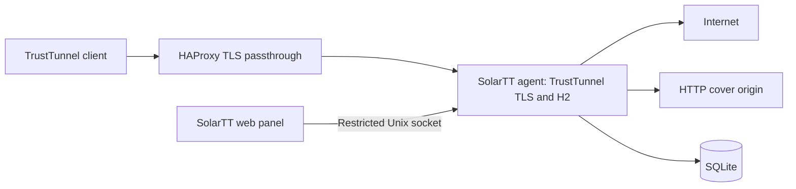

# SolarTT-UI

**Independent, self-hosted management for TrustTunnel.**

User provisioning, device profile limits, traffic quotas, expiry, profile export, and individual session
revocation, with a lightweight web interface. Community project, not an official
TrustTunnel product.

## Development status

Version 0.1 is under development. Current development packages are alpha.2 with
audited profile exports, bounded storage and schema-2 migration. Preserve a
compatible snapshot before upgrading; alpha.1 cannot open schema 2. See
[storage and audit semantics](docs/storage-and-audit.md). No production deployment
or stability claims.
Actual alpha.1 → alpha.2 upgrade, guarded rollback and restore passed on a fresh
GitHub-hosted VM: [pilot evidence](docs/pilot-review-2026-10-06.md).
Android and sustained real-network acceptance remain pending; see the
[manual pilot plan](docs/manual-pilot-plan.md).
The packaging permission fix and private-umask Ubuntu acceptance passed on
2026-10-11; an existing-node isolated process pilot also passed:
[current process and CI evidence](docs/process-pilot-review-2026-10-11.md).
Release gates include per-user TCP/UDP quotas, closure of that user's TLS sessions
without interrupting another user, crash recovery, client compatibility and
installation on a clean VM.

## Architecture



The initial scope is one Linux x86_64 node, HTTP/2, TCP and UDP. IPv6, QUIC,
ICMP, speed shaping, payments and multi-node orchestration are outside v0.1.
Quota means forwarded payload in both directions, not the provider's network bill.

## Device setup

Open a user's **Access settings** to set the device profile limit (0–16), or set it
when creating the user. Choose **Add device**, enter a name, and create its
connection profile. The next screen opens the TrustTunnel app, shows a local QR,
or lets you copy the link/download TOML. Each profile has separate revocation.
The layout uses cards on phones; password changes and revocation are under More.

The limit counts issued, non-revoked profiles, including offline ones. It does
not detect a profile copied to another physical device. Revoke profiles before
lowering the limit below their current count. See [access semantics](docs/architecture.md).

## Build prerequisites

Rust 1.95.0, Python 3, a C/C++ compiler, CMake and libclang. Heavy native builds
run in CI; production nodes receive packaged binaries.

```sh
python3 scripts/prepare_upstream.py
cargo test
# Native/network tests require the full C/C++ toolchain:
cargo test -p solartt-agent
```

See [architecture](docs/architecture.md), [release gates](docs/release-gates.md),
[runtime requirements and pilot sizing](docs/system-requirements.md),
[installation](docs/install.md), [backup and upgrade](docs/backup-upgrade.md),
[client compatibility](docs/client-compatibility.md),
[dependency notices](docs/dependency-notices.md), [contributing](CONTRIBUTING.md)
and [security](SECURITY.md).

## License

Apache-2.0. TrustTunnel retains its upstream copyright and license. Derived
builds identify their exact upstream commit and patch set.
